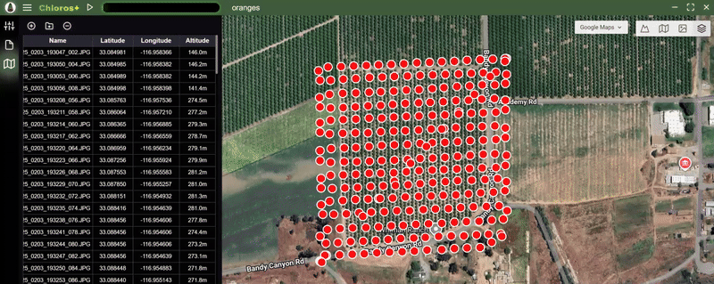

# Introduzione

<figure><figcaption></figcaption></figure>

Chloros
è un&#x27;applicazione software di [MAPIR
](https://www.mapir.camera) che consente di elaborare immagini multispettrali, controllare in tempo reale l&#x27;hardware MAPIR
e registrare i dati dei sensori. Chloros
1.3.0 supporta l&#x27;intera famiglia di prodotti MAPIR
:

* **Telecamere Survey3** — elaborano le acquisizioni RAW+JPG trasformandole in mappe calibrate di riflettanza e indici di vegetazione. Vedi [Telecamere supportate](supported-cameras.md).
* **Telecamere LATTICE** — collegamento in tempo reale dei moduli di telecamere multispettrali GigE, singolarmente o come array multitelecamera sincronizzati: anteprima, acquisizione ed elaborazione in prodotti calibrati di radianza e riflettanza. Vedi la [sezione LATTICE](lattice/README.md).
* **Sensori di luce DAQ** — Sensori spettrali DAQ-U (USB), DAQ-M (Bluetooth) e DAQ-E e DAQ-E-S (Ethernet): spettri calibrati in tempo reale, registrazioni `.daq` e illuminazione discendente per l’elaborazione della riflettanza. Vedi la [sezione DAQ](daq/README.md).


**Novità di Chloros
1.3.0**: gli assistenti AI possono gestire Chloros
tramite `chloros-mcp`, mentre l’CLI
, l’SDK
e `chloros-mcp` offrono le stesse funzionalità. I prodotti LATTICE index sono stati migliorati, gli array di sensori completi sono più veloci e funzionano su qualsiasi rete, e il backend continua a funzionare tra un comando e l’altro. Consulta l’elenco delle novità qui sotto e [scarica](download.md) i programmi di installazione.



**Utilizzi Chloros
con un assistente AI?** Questo manuale è pensato proprio per questo. Indica al tuo assistente:

* `https://mapir.gitbook.io/chloros/llms.txt` — indice leggibile da macchina di ogni pagina.
* Qualsiasi pagina in formato Markdown grezzo — aggiungi `.md` al suo URL
(ad es. `https://mapir.gitbook.io/chloros/reference/cli-reference.md`).
* Il [Riferimento CLI
](reference/cli-reference.md) e il [Riferimento SDK
](reference/sdk-reference.md) — pagine di riferimento complete e con valori esatti, scritte per l’utilizzo da parte dei modelli di linguaggio di grandi dimensioni (LLM).

Esempio di prompt: *&quot;Leggi https://mapir.gitbook.io/chloros/reference/cli-reference.md,, quindi scrivi uno script che effettui l&#x27;accesso ed elabori la cartella ~/flights/flight_001 in file GeoTIFF di riflettanza + NDVI
.&quot;*

Oppure fai eseguire direttamente Chloros
: `chloros-mcp`, un server MCP installato con l’SDK
, funziona con Claude Desktop, Claude Code, Cursor e altri client MCP.

Guida completa: [Utilizzo di Chloros
con gli assistenti AI](ai-assistants.md).


***

## Novità di Chloros
1.3.0

* **Gli assistenti AI possono gestire Chloros
.** `chloros-mcp`, un server MCP installato con l’SDK
Python
, consente a Claude Desktop, Claude Code, Cursor e altri client MCP di elaborare immagini e gestire telecamere LATTICE, array e sensori di luce DAQ. Vedi [Utilizzo di Chloros
con gli assistenti AI](ai-assistants.md).
* **L’CLI
, l’SDK
e `chloros-mcp` offrono le stesse funzionalità.** Per motivi di sicurezza, solo l’accesso, il provisioning DAQ-E e i server DAQ diretti rimangono nell’CLI
. Alcuni script della versione 1.2.0 richiedono modifiche: consultare la sezione **Modifiche nella versione 1.3.0** all’inizio della [Guida di riferimento alla CLI
](reference/cli-reference.md) e della [Guida di riferimento all’SDK
](reference/sdk-reference.md).
* **Miglioramento dei prodotti indice LATTICE.** L’NDVI
e gli altri prodotti indice esportati dalle acquisizioni LATTICE sono stati migliorati in ogni modalità di elaborazione.
* **Opzioni del programma di installazione per Windows
.**Nella sezione**Impostazioni di sistema**, il programma di installazione offre le opzioni**Abilita percorsi lunghi di Windows
**ed**Escludi il backend Chloros
dalla scansione di Microsoft Defender**, entrambe selezionate per impostazione predefinita. La prima opzione consente di creare cartelle di progetto con percorsi più lunghi di 260 caratteri; la seconda impedisce che la scansione in tempo reale rallenti l’acquisizione delle immagini (circa il 30% della velocità di acquisizione a velocità elevate). Il programma di installazione ora aggiunge inoltre la cartella CLI
a `PATH` una sola volta e rimuove le voci duplicate lasciate dai programmi di installazione precedenti. Vedi [Download](download.md).
* **Le cartelle di progetto con percorsi troppo profondi vengono rifiutate a priori.** Con i percorsi lunghi di Windows
disattivati (impostazione predefinita di Windows
), una cartella di progetto troppo profonda per il limite di 260 caratteri del percorso viene rifiutata prima che venga eseguita qualsiasi operazione, indicando la cartella di progetto più lunga che rientra nel limite e come abilitare i percorsi lunghi. In precedenza, un’esecuzione di questo tipo non generava alcun prodotto. Con i percorsi lunghi abilitati, i prodotti in cartelle molto profonde mantengono ora i propri metadati (tag GPS e XMP).
* **Maschere di clipping.** Quando la separazione delle bande di un prodotto di radianza o riflettanza LATTICE produce un valore di banda negativo, tale valore viene troncato a zero e una maschera per pixel, contenuta in una cartella `clamp_masks/` accanto alle cartelle dei prodotti, registra quali pixel e bande sono stati interessati. Il prodotto assegna un nome alla propria maschera nel tag `Chloros:UnmixClampMask`. Le visualizzazioni in tempo reale ora applicano il clipping esattamente come avviene durante l’esportazione. Vedi [Formati delle immagini di output](output-image-formats.md).
* **I prodotti descrivono se stessi.** I prodotti di indice riportano i propri tag di elaborazione (`Chloros:ProcessingLevel=index`, l’espressione dell’indice e se sono stati calcolati dalla radianza o dalla riflettanza) anziché quelli del file raw di origine. I prodotti Survey3
riportano i tag di elaborazione Chloros
in ogni modalità di elaborazione. I file raw e debayered di LATTICE mantengono l’orientamento nativo del sensore e registrano tale orientamento nell’XMP; l’Image Viewer li ruota solo ai fini della visualizzazione.
* **I pacchetti Linux
vengono forniti già decompressi.** Il backend e la CLI
vengono installati come cartelle all’interno di `/usr/lib/chloros/`, quindi non si decomprimono più ad ogni avvio. Su x86_64 il backend non impiega più circa 100 secondi per avviarsi e il file `.deb` ha dimensioni pari a circa la metà di quelle precedenti. ExifTool, incluso nel pacchetto, ora funziona su un&#x27;installazione pulita di Ubuntu. `.deb` ora installa anche l&#x27;Python
SDK
per il sistema `python3` (installatelo con `sudo apt install ./chloros_1.3.0_<arch>.deb`), aumenta i buffer di ricezione dei socket del kernel necessari per i flussi della fotocamera e aggiunge un servizio di backend che gira come utente. Il pacchetto Jetson, `chloros_1.3.0_arm64_jp6.deb`, è compilato per JetPack 6 ed esegue le elaborazioni sulla GPU del Jetson utilizzando la versione CUDA di PyTorch fornita da JetPack. Su Linux
ogni immagine esportata ora raggiunge il disco una sola volta (viene scritta e contrassegnata in memoria, quindi copiata nella posizione definitiva): su un Jetson, dove è il disco a dettare il ritmo, un&#x27;esecuzione di LATTICE con 288 immagini richiede 14 minuti invece di 24. Vedi [Installazione su Linux
](linux/linux-installation.md).
* **Le telecamere LATTICE OCN
leggono con maggiore precisione alla luce del sole.** Radianza, riflettanza e indici ricevono una correzione rapida dopo la separazione delle bande, quindi un bersaglio grigio viene letto con un NDVI
vicino al neutro in pieno sole. Le telecamere RGN
rimangono invariate.
* **Segnalazione dei bug dall’app.** Un’icona a forma di bug nella parte superiore della scheda “Debug Log” invia a MAPIR
una descrizione, fino a 10 immagini, i log e i dettagli di sistema. Vedi [GUI: Navigazione](navigation.md).
* **Array LATTICE.**Per impostazione predefinita, gli array mantengono il sensore completo, e il trasporto compresso a 12 bit (`--packed`, predefinito `auto`) aumenta la frequenza dei fotogrammi del sensore completo di circa un terzo; un array funziona su qualsiasi rete alla frequenza di fotogrammi consentita dalla stessa (un collegamento lento riduce la frequenza di fotogrammi invece di rifiutare l’array o ridurne i fotogrammi); un array le cui telecamere subiscono un riavvio si ripristina automaticamente, con il PTP nuovamente attivo; l’esposizione automatica non riduce più tale frequenza in condizioni di scarsa illuminazione (riempie il periodo, quindi aumenta il guadagno); L’acquisizione continua tiene il passo con gli array veloci; un controllo**Highlights** per le telecamere RGB
; e l’SDK
`ArraySession` acquisisce `grab()`, `frame_stream()` e `continuous()`. Vedi la [sezione LATTICE](lattice/README.md).
* **Esposizione automatica più stabile.** L’esposizione rimane costante in condizioni di luce stabile e si stabilizza entro pochi secondi da un cambiamento; le piccole luci in sovraesposizione non scuriscono più la scena; un’esposizione manuale mantiene il guadagno su «Auto»; e una fotocamera che smette di rispondere in pieno sole viene mantenuta al livello adeguato alla sua luce, rilevata dal sensore di luce o, in assenza di sensore collegato, dai fotogrammi della fotocamera stessa. Vedi [Impostazioni della fotocamera](lattice/camera-settings.md).
* **Sensori di luce.** **Supporto DAQ-E-S:** il suo diffusore fisso non richiede alcuna correzione del cappuccio e ogni lettura riporta l’inclinazione, il rollio e il beccheggio dell’unità. Una registrazione indica se il cappuccio è stato selezionato o presunto, e l’elaborazione avvisa in caso di cappuccio presunto: DAQ-U, DAQ-M e DAQ-E vengono forniti senza cappuccio, quindi è necessario specificare quello montato. Le registrazioni `.daq` in tempo reale sopravvivono a un&#x27;interruzione di corrente (conservare un file `.daq-journal` insieme al relativo `.daq`), e un DAQ-E che smette di trasmettere viene ricollegato con l’intervallo contrassegnato nella sua registrazione. Un progetto che contiene solo registrazioni dei sensori di luce le elenca ed elabora tramite l’app e la CLI
, e una registrazione effettuata con l’`chloros_scripts` viene elencata come il DAQ che l’ha effettuata, con un limite massimo che è possibile impostare. Ogni acquisizione salva la lettura del DAQ utilizzata. Vedere la [sezione DAQ](daq/README.md).
* **Elaborazione.**I frame LATTICE iniziano l’elaborazione durante il rilevamento del bersaglio. I riferimenti del bersaglio e del DAQ vengono stabiliti per ciascuna banda. Un progetto spostato ricollega i propri file. Le esportazioni di un’acquisizione a 8 bit sono a 8 bit, con un nuovo formato**TIFF
(8 bit)**. Un&#x27;esecuzione di Survey3
senza bersaglio di calibrazione viene archiviata come prodotto di riserva (`Vignette_Corrected_Images` o `Sensor_Response_Images`), non come immagine di riflettanza. I tag DLS per banda di un&#x27;immagine di riflettanza corrispondono sempre a quelli del proprio fotogramma. La funzione &quot;Texture Aware&quot; non è disponibile per le acquisizioni LATTICE, che utilizzano sempre il debayer standard.
* **CLI
e SDK
.** I percorsi di output relativi ora puntano alla cartella da cui si esegue il comando o lo script (in precedenza, un backend installato li risolveva nella propria cartella di installazione, causando un errore). Il backend rimane in esecuzione tra un comando e l’altro e si arresta automaticamente dopo 30 minuti di inattività; la gestione è affidata a `chloros-cli backend status` e `backend stop`. I comandi di acquisizione elencano tutti i file che non sono riusciti a scrivere e terminano con codice 1; le acquisizioni ripetute si interrompono quando il disco è pieno. Un&#x27;esecuzione riuscita di `process` genera il codice di stato `Image products written: N (plus M clamp masks)`. Su Windows
, `ChlorosLocal` / `process_folder` individuano il backend installato (e ne utilizzano uno già in esecuzione), mentre `read_image_audit_tags` funziona da un semplice `pip install`.

***

## Novità di Chloros
1.2.0

* **Controllo live delle telecamere — nuova scheda “Telecamere”.** Collegamento delle telecamere LATTICE una alla volta o come array multicamera sincronizzati (sincronizzazione temporale PTP, acquisizione attivata dall’hardware), con sovrapposizioni di anteprima in tempo reale, istogrammi per banda, esposizione automatica intelligente, calcolatore di indice in tempo reale e aggiornamenti del firmware delle telecamere direttamente dall’app.
* **Sensori di luce — nuova scheda “Sensori di luce”.** Collega i sensori DAQ-U (USB), DAQ-M (Bluetooth) e DAQ-E (Ethernet); visualizza spettri calibrati in tempo reale (W/m²/nm), registra file `.daq` nel tuo progetto, seleziona profili di correzione cap e aggiorna il firmware DAQ-E tramite rete.
* **Modalità di acquisizione e registratori.** Acquisizione singola / continua / a intervalli, oltre a una modalità di acquisizione “Fastest Capture” solo in formato raw; selezione per progetto delle telecamere e dei tipi di esportazione generati da “Capture All”; registratori array per video indicizzati di livello di monitoraggio e burst raw di livello analitico con creazione di video offline.
* **Pipeline di elaborazione LATTICE.** Importa le cartelle di acquisizione LATTICE e scomponi ogni fotogramma grezzo in prodotti debayered, di anteprima, di radianza float32 (W/m²/sr/nm) e di riflettanza con opzioni di attivazione/disattivazione per ciascun prodotto. La riflettanza può provenire da un bersaglio di calibrazione all’interno del fotogramma o da un segnale in discesa DAQ; l’allineamento dell’array viene applicato alle esportazioni; la calibrazione di fabbrica mancante viene scaricata automaticamente in base al numero di serie della telecamera.
* **I progetti memorizzano le impostazioni hardware.** Le telecamere e i sensori di luce collegati vengono salvati con il progetto (`cameras.json` / `sensors.json`) e si riconnettono con le impostazioni salvate quando si riapre il progetto. Vedi [GUI: Progetti](projects.md).
* **Aggiornamenti del visualizzatore di immagini.** Lettura dei pixel/indici del cursore con corretto ridimensionamento della riflettanza per ogni file, istogrammi dei livelli, cursore di binning GSD, modalità griglia «Per Trigger» / «Per Camera», visualizzazioni dei prodotti LATTICE ed esportazioni su disco delle sandbox di indici/LUT.
* **CLI
e SDK
, notevolmente ampliati.** Nuove famiglie di comandi `lattice`, `daq pool-*`, `project` e `time-sync`; nuove opzioni `process` (`--input-level`, opzioni di attivazione/disattivazione per singolo prodotto, `--reflectance-source`, flag di allineamento degli array); handle smart-connect SDK
(`connect_camera` / `connect_array` / `connect_daq_sensor`) che avviano automaticamente il backend; Automazione `open_project()`; il pacchetto SDK
è incluso negli installer e pubblicato su PyPI come `chloros-sdk`.
* **Semantica di errore trasparente.** Un&#x27;esecuzione di `chloros-cli process` che ha richiesto prodotti ma non ne ha generato alcuno ora fallisce in modo evidente e termina con un codice di uscita diverso da zero; le esecuzioni riuscite riportano il numero di prodotti immagine generati.
* **Nuovo layout di output.** I prodotti vengono salvati in cartelle `<project>/<camera>/<format>/<Product>_Images/` e mantengono il nome del file sorgente — è la cartella, non un suffisso del nome del file, a identificare il prodotto. Vedi [Formati delle immagini di output](output-image-formats.md).
* **Più input, piani e lingue.** Supporto per l’input `.dng`; tutte le 38 lingue dell’interfaccia sono ora completamente disponibili; limiti hardware per piano con utilizzo gratuito (senza login) fino a 4 telecamere e 2 sensori di luce.
* **Affidabilità.** La funzione “Interrompi elaborazione” termina correttamente con un riepilogo accurato dell’esecuzione, i progetti multicamera esportano i dati di ogni singola telecamera e gli aggiornamenti del programma di installazione non causano più la disconnessione dell’utente.***

Chloros
è disponibile in 3 interfacce applicative:

## Chloros
: applicazione GUI desktop

Finestra separata autonoma con tutte le funzionalità, comprese le schede “Telecamere in diretta” e “Sensori di luce”. _Solo per Windows._

## [Chloros
CLI
: interfaccia a riga di comando](CLI.md)

Elaborazione batch da riga di comando più comandi in tempo reale `lattice`, `daq pool-*`, `project` e `time-sync`. Ideale per l’automazione, la creazione di script e il funzionamento in modalità headless. Disponibile su **Windows
, Linux
amd64 e Linux
arm64 (NVIDIA Jetson)**. _Per accedere alla CLI
è necessario un piano a pagamento Chloros
+._

## [Chloros
API
: Python
SDK
](api-python-sdk.md)

Interfaccia Python
programmatica per l’automazione e i flussi di lavoro personalizzati: elaborazione completa della pipeline, sessioni live con telecamere/array, sessioni con sensori DAQ e automazione dei progetti salvati. Si installa con il pacchetto desktop/CLI ed è pubblicato anche come `pip install chloros-sdk`. _L’API richiede un piano a pagamento Chloros
+ per l’accesso._

***

## Piattaforme supportate

| Piattaforma | GUI | CLI
| Python
SDK
|
| --- | --- | --- | --- |
| **Windows
10/11 (x64)** | Sì | Sì | Sì |
| **Linux
amd64 (x86_64)** | No | Sì | Sì |
| **Linux
arm64 (NVIDIA Jetson)** | No | Sì | Sì |

Per le istruzioni di installazione su Linux
, consultare la sezione [Linux
e Edge Computing](linux/linux-overview.md).

***

## Per iniziare in tre passaggi

1. **Installazione** — scarica ed esegui il programma di installazione per la tua piattaforma. Vedi [Download](download.md).
2. **Accedi (facoltativo per l’interfaccia grafica)** — l’interfaccia grafica elabora le immagini gratuitamente senza bisogno di un account. Un [login a Chloros
+](chloros+-login.md) sblocca l’elaborazione parallela, l’accelerazione GPU, limiti più elevati per i dispositivi e l’accesso a CLI
e SDK
.
3. **Crea il tuo primo progetto** — apri Chloros
, crea un [Nuovo progetto](projects.md), [aggiungi le tue immagini](processing-images-gui/adding-files-to-a-project.md) e [avvia l’elaborazione](processing-images-gui/starting-the-processing.md). Per controllare invece l’hardware in tempo reale, apri la scheda “Telecamere” o “Sensori di luce” — consulta [GUI: Navigazione](navigation.md).

***

## Chloros
+

Sebbene Chloros
sia gratuito per la maggior parte delle attività, potresti scoprire di aver bisogno di qualcosa in più. È qui che una licenza a pagamento per Chloros
+ può tornarti utile. Con una licenza Chloros
+ puoi sbloccare nuove funzionalità quali:

* **Elaborazione multithread**: accelera notevolmente l’elaborazione delle immagini per progetti di grandi dimensioni elaborandole simultaneamente attraverso la pipeline.
* **Accelerazione GPU (CUDA)**: sfrutta le attuali opzioni di memoria GPU più capienti per velocizzare ulteriormente la pipeline di elaborazione delle immagini. Per ottenere risultati ottimali, consigliamo almeno 4 GB di VRAM.
* **Chloros
+**[**CLI**](CLI.md) **Accesso**: esegui Chloros
+ dalla riga di comando per automatizzare e integrare il programma nel tuo software. Disponibile su qualsiasi piano a pagamento; applicato lato server.
* **Chloros
+**[**API**](api-python-sdk.md) **Accesso:** esegui Chloros
+ da Python
per il controllo programmatico, consentendo una perfetta integrazione con le tue pipeline di ricerca, i flussi di lavoro di analisi dei dati e le applicazioni personalizzate. Disponibile su qualsiasi piano a pagamento; applicato lato server.
* **Limiti hardware più elevati**: collega più telecamere e sensori di luce contemporaneamente. Senza effettuare il login, l’interfaccia grafica (GUI) consente di collegare fino a 4 telecamere e 2 sensori di luce DAQ; i piani a pagamento aumentano entrambi i limiti:

| Piano | Telecamere | Sensori di luce DAQ |
| --- | --- | --- |
| Iron (gratuito, senza accesso) | 4 | 2 |
| Copper / Bronze | 6 | 3 |
| Silver | 10 | 6 |
| Gold | 20 | 12 |

* **Utilizzo su più dispositivi**: ogni licenza Chloros
+ consente di registrare 2 o più dispositivi. Utilizza il tuo account MAPIR
Cloud per gestire i dispositivi registrati. Aggiungi il supporto per ulteriori dispositivi effettuando l’upgrade della tua licenza Chloros
+.
* **Metodo avanzato di debayering sensibile alla texture:** un debayering di alta qualità sensibile ai bordi, combinato con un modello di riduzione del rumore basato su IA/ML che elimina quasi tutto il rumore di debayering.
* **Formule personalizzate per indici multispettrali:** inserisci indici multispettrali personalizzati nei calcolatori raster di Chloros
, sia per l’elaborazione che per l’area di prova di visualizzazione delle immagini.
* **Linux
ed edge computing:** esegui Chloros
su piattaforme Linux
x86_64 e ARM64, incluso NVIDIA Jetson, per l’elaborazione sul campo e edge. Consulta la [Panoramica su Linux
](linux/linux-overview.md).

<a href="https://cloud.mapir.camera/pricing" class="button primary" data-icon="envira">Prezzi e registrazione a Chloros+</a>

<figure><figcaption></figcaption></figure>

<figure><figcaption></figcaption></figure>

<figure><figcaption></figcaption></figure>

<figure><figcaption></figcaption></figure>

<figure><figcaption></figcaption></figure>

<figure><figcaption></figcaption></figure>
<!-- SCREENSHOT-UPDATE: cli.JPG shows the 1.1.0 CLI banner. Re-shoot a terminal running `chloros-cli --version` + `chloros-cli status` on the 1.3.0 build so the banner prints "Chloros CLI 1.3.0". -->
