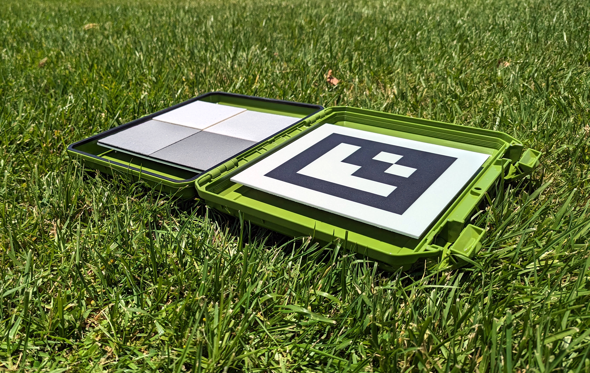

# Target di calibrazione

MAPIR offre una vasta gamma di target di calibrazione per soddisfare diverse applicazioni. Il modello compatto T4-R50, illustrato di seguito, contiene 4 pannelli la cui riflettanza luminosa è stata misurata nell’intervallo da 250 a 2.500 nm.

<figure><figcaption>
MAPIR T4-R50
</figcaption></figure>I bersagli di riferimento diffusi T4 presentano le seguenti curve di riflettanza, [scarica i dati qui](https://cdn.shopify.com/s/files/1/0972/5566/files/MAPIR_Diffuse_Reflectance_Standard_Calibration_Target_Data_T4.xlsx?v=1741759157):

<figure><figcaption>
Riflettanza MAPIR T4 :: 250-2.500 nm
</figcaption></figure>

<figure><figcaption>
Riflettanza MAPIR T4 :: 400-1.000 nm
</figcaption></figure>I bersagli di riferimento diffusi T4P presentano le seguenti curve di riflettanza, [scarica i dati qui](https://cdn.shopify.com/s/files/1/0972/5566/files/MAPIR_Diffuse_Reflectance_Standard_Calibration_Target_Data_T4.xlsx?v=1741759157):

<figure><figcaption>
Riflettanza MAPIR T4P :: 250-2500 nm
</figcaption></figure>

<figure><figcaption>
Riflettanza MAPIR T4P :: 400-1000 nm
</figcaption></figure>Osservando il grafico della riflettanza si può notare che i valori rappresentano la lunghezza d’onda (asse x) in funzione della percentuale di riflettanza (asse y). Quando acquisiamo un’immagine del bersaglio di calibrazione, creiamo quindi una relazione tra il valore del pixel e la percentuale di riflettanza, all’interno dello spettro a cui è sensibile ciascuna delle bande del sensore della fotocamera.

Ciò significa che per ogni immagine acquisita con le nostre telecamere, è possibile utilizzare una foto dei nostri bersagli di riflettanza, come il [T4-R50](https://www.mapir.camera/collections/calibration-targets/products/diffuse-reflectance-standard-calibration-target-package-t3-r50) o [T4-R125](https://www.mapir.camera/collections/multispectral-reflectance-reference-calibration-targets/products/diffuse-reflectance-standard-calibration-target-package-t4-r125), per calibrare le immagini in base alla riflettanza. Una volta effettuata la calibrazione, ogni pixel dell’immagine corrisponde alla percentuale di riflettanza.

Per i risultati di **Survey3**, se si esportano le immagini calibrate in Chloros nei formati standard JPG o TIFF, la percentuale di riflettanza viene calcolata dividendo il valore del pixel per la profondità di bit del formato immagine. Quindi, per il JPG si divide per 255, mentre per il TIFF si divide per 65.535. È anche possibile scegliere il formato di output PERCENT in Chloros; in questo caso, ogni pixel avrà un valore compreso tra 0,0 e 1,0 (da 0% a 100% di riflettanza). Tieni presente, tuttavia, che alcune applicazioni di elaborazione delle immagini non supportano le immagini in percentuale (a virgola mobile) e che queste occupano molto spazio di archiviazione.


**La riflettanza LATTICE utilizza una scala di pixel diversa.** La riflettanza LATTICE viene memorizzata con DN 32768 = 100% di riflettanza (non 65535), e ogni file contiene un tag XMP `Chloros:PixelScale` che ne indica la scala. Leggere il tag e dividere per il valore indicato, anziché ipotizzare una costante — vedere [Formati delle immagini di output](output-image-formats.md).


## Target di calibrazione con le telecamere LATTICE

Con le telecamere LATTICE, un target di calibrazione è **facoltativo** per la riflettanza: Chloros, infatti, può riferire la riflettanza all’irraggianza discendente misurata da un sensore di luce DAQ (ρ = π·L/E). Il riferimento viene scelto tramite l’impostazione della sorgente di riflettanza del progetto, configurata con `chloros-cli process --reflectance-source` (l’interfaccia grafica non dispone di alcun controllo per questa impostazione e utilizza il valore memorizzato nel progetto, `auto` per impostazione predefinita — vedi [Impostazioni del progetto](project-settings/project-settings.md)):

| Valore | Comportamento |
| --- | --- |
| `auto` *(impostazione predefinita)* | Un target all’interno del fotogramma che supera il controllo di qualità (QA) costituisce il **riferimento assoluto**; in assenza di un target o in caso di fallimento del QA, Chloros ricorre alla divisione downwelling del DAQ. Un target che supera il controllo di qualità con un flag (un pannello escluso o una banda non funzionante) non viene automaticamente privilegiato: le catene target, target+DAQ e solo DAQ vengono provate in ordine di punteggio misurato sui pannelli tenuti da parte. |
| `target` | Solo bersaglio rigoroso — nessuna sostituzione DAQ. |
| `daq` | DAQ autorevole — la misurazione downwelling è sempre il riferimento. |

Comportamento aggiuntivo dei target per LATTICE:

* **Geometrie dei target** — Sono supportati pannelli contrassegnati con ArUco, pannelli con ROI fissa e target a striscia; la geometria deriva dalla configurazione dei target del progetto.
* **Dati dei bersagli misurati per unità** — `--target-reflectance-dir DIR` punta a una directory contenente le scansioni di riflettanza dei bersagli misurate per unità (`<serial>.csv`, individuate tramite il numero di serie/QR dell’unità del bersaglio). In caso di mancata individuazione, Chloros ricorre agli spettri nominali T3/T4P.
* **Ancoraggio temporale** — un bersaglio rilevato calibra i fotogrammi circostanti e viene mantenuto tra un avvistamento e l’altro.

La semantica completa dei flag e gli esempi sono disponibili nella [Guida di riferimento CLI](reference/cli-reference.md) (vedere "Opzioni di esportazione per prodotto").

### F988

"La riflettanza F988 viene calibrata utilizzando un pannello di riflettanza presente nella scena: la banda si trova al di fuori dell’intervallo calibrato del sensore di luce DAQ, quindi Chloros applica l’ultima acquisizione del pannello effettuata dall’utente e la mantiene tra un rilevamento e l’altro del pannello."

Se F988 viene eseguito con la calibrazione basata esclusivamente sul DAQ, Chloros rifiuta la riflettanza basata sul DAQ per quella banda e ne spiega il motivo (motivo di esclusione `dls-uncalibrated-band-988`); il flusso di lavoro con il pannello è la procedura supportata.

<figure><figcaption>
T4-R125
</figcaption></figure> <figure><figcaption>
T4-R125
</figcaption></figure> <figure><figcaption>
T4-R125
</figcaption></figure>

