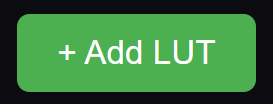

# Interfaccia grafica: Navigazione

Quando si avvia Chloros per la prima volta, viene avviato il suo backend di elaborazione. Una volta che il backend è pronto, viene visualizzata l'icona del menu principale in alto a sinistra  e le schede "Telecamere" e "Sensori di luce" nella barra laterale sinistra diventano attive (fino a quel momento sono disattivate).

<figure><figcaption></figcaption></figure>

Da sinistra a destra, l’intestazione superiore contiene:

###  Menu principale

<figure><figcaption></figcaption></figure>

<figure><figcaption></figcaption></figure>Dal menu principale è possibile:

* **Nuovo progetto**— creare un nuovo progetto. Se sono stati salvati dei modelli di progetto, viene visualizzato un menu a tendina**Seleziona modello** che consente di avviare il nuovo progetto utilizzando le impostazioni di un modello.
* **Apri progetto**— aprire un progetto esistente. L’elenco include un pulsante**Apri cartella del progetto** che apre la cartella dei progetti nel tuo Esplora file.
* **Duplica progetto** — copia il progetto attualmente aperto con un nuovo nome (viene suggerito un nome libero come "Il mio progetto (2)") e apri la copia. _(visibile dopo l’apertura di un progetto)_
* **Aggiungi file** — aggiunge singoli file immagine al progetto corrente _(visibile dopo l’apertura di un progetto)_
* **Aggiungi cartella** — aggiunge una o più cartelle di immagini al progetto corrente _(visibile dopo l’apertura di un progetto)_
* **Avvia elaborazione / Interrompi elaborazione** — avvia o interrompi la pipeline di elaborazione delle immagini _(abilitato dopo l’aggiunta dei file)_
* **Connetti alla telecamera** — passa alla [scheda Telecamere](lattice/) per collegare una telecamera o un array LATTICE. Funziona anche senza un progetto aperto.
* **Connetti al sensore di luce** — passa alla [scheda Sensori di luce](daq/) per collegare un sensore di luce DAQ. Funziona anche senza un progetto aperto.


**Solo Windows**: l’interfaccia grafica Chloros Desktop è disponibile su Windows. Gli utenti Linux dovrebbero consultare la documentazione relativa alla [CLI](CLI.md) e al [Python SDK](api-python-sdk.md) per l’elaborazione in modalità headless.


### 

Pulsante Riproduci/Avvia

Quando è abilitato, il pulsante di avvio dell’elaborazione avvia la pipeline di elaborazione delle immagini.

### 

Barra di avanzamento 

Nella modalità gratuita Chloros, che elabora tutti i file in sequenza, la barra di avanzamento mostrerà 2 fasi: Rilevamento del bersaglio ed Elaborazione.

Nella modalità a pagamento Chloros+, che elabora tutti i file contemporaneamente, la barra di avanzamento mostra 4 fasi: Rilevamento, Analisi, Calibrazione, Esportazione. Se si posiziona il cursore del mouse sulla barra di avanzamento di Chloros+, si aprirà il pannello esteso con le 4 fasi della barra di avanzamento, in modo da poter seguire l’avanzamento. Facendo clic sulla barra di avanzamento in alto si bloccherà il pannello a tendina; facendo nuovamente clic lo si sbloccherà.

<figure><figcaption></figcaption></figure>

## Menu laterale

Il menu laterale sinistro contiene varie icone con cui interagire, in questo ordine dall’alto verso il basso:

####  [Impostazioni progetto](project-settings/project-settings.md)

La scheda Impostazioni progetto consente di regolare le impostazioni globali del progetto e quelle relative all’elaborazione. Modifica queste impostazioni prima di iniziare a elaborare i tuoi file.

####  Esploratore file

Aggiungi file/cartelle e rimuovi file dal progetto. I file duplicati vengono ignorati. Seleziona la casella della colonna "Destinazione" per qualsiasi immagine di destinazione: l’elaborazione prenderà in considerazione solo le immagini selezionate come destinazioni, velocizzando notevolmente i tempi di elaborazione. Utilizza il pulsante di alternanza “Immagine/Metadati” per passare dalla visualizzazione della griglia di miniature dell’immagine selezionata a una tabella dettagliata dei metadati.

####  [Visualizzatore immagini](image-viewer-gui/opening-an-image-full-screen.md)

Quando si fa clic su un'immagine nel visualizzatore principale, questa viene aperta a schermo intero nella scheda Visualizzatore immagini.

####  [Visualizzatore mappe](image-viewer-gui/map-markers.md)

Visualizza le tue immagini su una mappa 2D interattiva in base alle loro coordinate GPS. Supporta i provider di tile Google Maps ed ESRI, selezionando automaticamente il servizio più adatto alla propria posizione. Passare il mouse sui marcatori per visualizzare le anteprime delle immagini in miniatura.

####  [Telecamere](lattice/)

Collegare e controllare le telecamere LATTICE in tempo reale — una alla volta o come array multicamera sincronizzati. La scheda mostra riquadri di anteprima in tempo reale con sovrapposizioni e istogrammi, impostazioni per singola telecamera e per gruppo, nonché le Impostazioni di acquisizione che determinano quali telecamere e tipi di esportazione vengono generati dalla funzione “Acquisisci tutto”. Disponibile una volta che il backend è pronto; consulta la [sezione LATTICE](lattice/) per la guida completa.

####  [Sensori di luce](daq/)

Collega i sensori di luce DAQ — DAQ-U (USB), DAQ-M (Bluetooth) e DAQ-E (Ethernet) — e visualizza i loro grafici spettrali calibrati in tempo reale in W/m²/nm. Da qui è possibile registrare file `.daq` nel progetto aperto, rinominare i sensori, selezionare i profili di correzione cap e aggiornare il firmware del DAQ-E. Disponibile una volta che il backend è pronto; consultare la [sezione DAQ](daq/) per la guida completa.

####  Registro di debug

Controlla il registro per i messaggi di debug quando si verificano problemi. Copia/scarica il registro e invialo all’[Assistenza MAPIR](https://www.mapir.camera/community/contact) per ricevere assistenza.

Novità nella versione 1.3.0: l’icona del bug nella parte superiore della scheda del log (**Segnala un bug**) invia a MAPIR una segnalazione contenente la vostra descrizione, fino a 10 immagini, i log di Chloros e i dettagli di sistema. Per inviarla è necessario aver effettuato l’accesso. Vedi [Segnalazione di un bug dalla scheda del log](processing-images-gui/monitoring-the-processing.md#reporting-a-bug-from-the-log-tab).

####  [Accesso utente](chloros+-login.md)

La barra laterale di accesso utente consente di accedere al proprio account Chloros+ per sbloccare funzionalità avanzate. È inoltre possibile visualizzare la versione corrente dell'applicazione, nonché impostare la lingua del testo visualizzato nell'interfaccia grafica (GUI) e nella CLI di Chloros.
